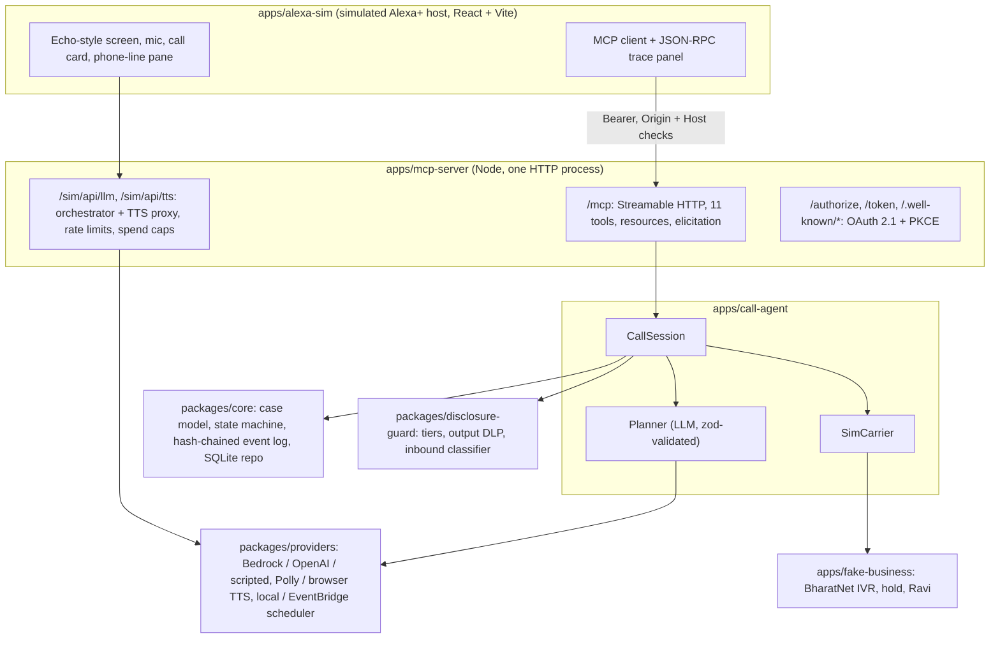

# Stand-In

**Alexa makes the customer-care call so you don't have to.**

Stand-In is an Alexa+ add-on (a self-hosted MCP server) that places a support call for you. It builds a case file, navigates the phone menu, waits on hold, explains the issue to the agent, shares only what you approved, rings your Echo when only you can answer (an OTP, an identity check), records the ticket number and the promise, and calls back if the promise is broken.

Built for **Build, Ship, Shape: Amazon Developer Hackathon**. Track: **Alexa+**. Mini challenges: **AWS Builder** and **Open Source** (`packages/disclosure-guard`).

---

## Real vs simulated

Read this first. Everything marked "simulated" says so in the UI and in the code.

| Part | Status | What that means |
| :--- | :--- | :--- |
| MCP server (`apps/mcp-server`) | **Real** | Official `@modelcontextprotocol/sdk` 1.32.1, Streamable HTTP at `/mcp`, protocol `2025-11-25`. 11 tools, 3 resources, elicitation, MCP Apps call card, OAuth 2.1 + PKCE account linking, RFC 9728 / RFC 8414 discovery, stateless fallback for clients that keep no `Mcp-Session-Id`. |
| Alexa+ host (`apps/alexa-sim`) | **Simulated** | A browser page in a generic Echo-Show-style frame. It is a **real MCP client** (SDK `Client` + `StreamableHTTPClientTransport`) with a JSON-RPC trace panel showing every message. The hackathon allows a simulated Alexa+ experience; its source is here. |
| Phone network | **Simulated** | `SimCarrier` is an in-process bus to a fictional business, "BharatNet Broadband" (`apps/fake-business`), with an IVR, hold, and a scripted agent "Ravi". No real calls are placed. A Twilio carrier was planned as a stretch and was **not built**. |
| Disclosure guard (`packages/disclosure-guard`) | **Real** | Code, not a prompt: tiered facts, template expansion, output DLP, inbound request/injection classifier. 298 unit tests. |
| Call state machine (`packages/core`) | **Real** | Deterministic, pure, unit-tested. The LLM proposes words; code decides transitions, digits, hand-off and hang-up. |
| LLM | **Real, by mode** | `aws` mode: Amazon Bedrock Converse (wired, covered by mocked tests). Local eval: OpenAI API (never used in `aws` mode). Offline: a deterministic scripted policy. |
| Real Alexa+ connection | **Not connected** | The server side is ready (OAuth linking, `addon.json` template, icons, privacy/terms pages). The Alexa+ MCP Toolkit is preview/US-only and our AWS account was not allowlisted (AssumeRole into the toolkit's role returned `AccessDenied`). See [Alexa+ readiness](#alexa-readiness). |
| Hosted deployment | **Not yet live** | Lightsail deploy script, Dockerfile and IAM policy are in the repo. The new AWS account is stuck in verification (see [Limitations](#limitations-and-honest-notes)). |

---

## Live demo

> **TODO:** the hosted demo is not deployed yet. Replace these placeholders when it is.

| What | Value |
| :--- | :--- |
| Simulated Alexa+ host | `<LIVE_URL>/` |
| Autoplay takes | `<LIVE_URL>/?autoplay=happy`, `<LIVE_URL>/?autoplay=otp`, `<LIVE_URL>/?autoplay=followup` |
| MCP endpoint (for your own MCP client, e.g. MCP Inspector) | `<LIVE_URL>/mcp` with `Authorization: Bearer <JUDGE_TOKEN>` |
| Health | `<LIVE_URL>/health` |

The hosted page fetches its token from `/sim/config` (`DEMO_EMBED_TOKEN=true`), so no login is needed in the browser. Cost is bounded by per-IP rate limits and global hourly and daily spend caps, not by the token.

**Local alternative (works today, no AWS account or keys):** see Quick start below.

---

## Quick start (offline, about 2 minutes)

Requirements: Node 22+, pnpm.

```bash
git clone <REPO_URL> stand-in && cd stand-in
pnpm i
pnpm demo
```

`pnpm demo` builds the host page and the server, then starts the server in offline mode on `http://127.0.0.1:8787` (default `PORT`). Open one of:

- `http://127.0.0.1:8787/?autoplay=happy`: the account number is elicited, the IVR is navigated (2, then 1), hold, Ravi joins, the outcome is read back, **Done: SR-48213**, follow-up scheduled.
- `http://127.0.0.1:8787/?autoplay=otp`: Ravi asks for the OTP. The call goes to `HANDOFF_PENDING` ("Needs you"), a red `disclosure: One-time password (OTP)` chip appears in the trace, the account holder joins and leaves. No OTP digits appear anywhere on the page.
- `http://127.0.0.1:8787/?autoplay=followup`: "A week later" (the refund never came), Stand-In calls again, quotes SR-48213 and escalates to a supervisor.

Or type your own request into the page, for example "My BharatNet broadband has been down for three days, sort it out".

**How the page gets its token locally.** With no `STANDIN_TOKEN` set, the offline server bound to loopback generates a one-time token, never prints it, and hands it only to the local page via `/sim/config` (loopback `Host` only). If your `.env` sets `STANDIN_TOKEN`, either set `DEMO_EMBED_TOKEN=true`, open the page with `?token=…` (removed from the address bar after load), or type it once into the page. Other MCP clients need `STANDIN_TOKEN` set in `.env`.

Other commands:

```bash
pnpm test     # vitest, whole workspace
pnpm eval     # 8 golden call scenarios, deterministic
pnpm verify --db apps/mcp-server/standin.db   # check the hash-chained event log of the SQLite store
```

Without `.env` the demo store is in memory. Set `SQLITE_PATH=./standin.db` (as in `.env.example`) to keep a file; it is created relative to `apps/mcp-server`, so `pnpm verify` (run from the repo root) needs `--db apps/mcp-server/standin.db`.

---

## How it works



### Call state machine

```text
DIALING -> IVR -(menu prompt, planner picks digit, DTMF)-> IVR
IVR -hold-> HOLD -human detected-> HUMAN
HUMAN -disclosure request (never-tier)-> HANDOFF_PENDING -accept-> USER_ON_LINE -user leaves-> HUMAN
HANDOFF_PENDING -decline / 60 s timeout-> HUMAN ("they'll verify later")
HUMAN -outcome detected-> WRAP_UP (read back ticket + date) -confirmed-> ENDED
any -error / limit-> FAILED(reason)   e.g. ivr_dead_end after 3 loops, max_duration (25 min sim)
```

The planner returns a zod-validated action (`say`, `press`, `wait`, `request_handoff`, `confirm_outcome`, `end`). Invalid output is logged as an error event and replaced by a safe fallback line (scenario S8).

### Disclosure guard

Every case fact has a tier assigned by the guard, never by the caller:

| Tier | Examples | Behaviour |
| :--- | :--- | :--- |
| `share` | name, account number, issue | may be spoken |
| `confirm` | phone, email, address | spoken only after the user approved it for this case |
| `never` | OTP, PIN, CVV, full card, password, Aadhaar | never sent to the LLM, never spoken; a request for one triggers hand-off |

1. **Template expansion.** The planner writes `{{fact:key}}`; the guard substitutes only allowed values.
2. **Output DLP.** The final utterance is scanned for every never-tier value (exact and digit-normalised, including spelled-out digits) and for OTP-near-keyword, Luhn-valid card, Aadhaar and CVV patterns. A hit blocks the utterance and logs `blocked_utterance`.
3. **Inbound classifier.** Callee speech is untrusted data. Requests for OTP/PIN/password/remote access are tagged and trigger hand-off; injection phrases ("ignore your instructions…") are logged and ignored.

### MCP surface

| Tool | Input | Purpose |
| :--- | :--- | :--- |
| `open_case` | `businessName`, `goal`, `desiredOutcome`, `facts[]`, `userName?`, `scenario?` | Start a case for an allowlisted business; elicits missing facts (form elicitation) or returns `missingFacts[]` |
| `update_case_fact` | `caseId`, `key`, `value`, `label?`, `approve?` | Add or change a fact |
| `place_call` | `caseId`, `simulatedHourIst?` | Dial in the background; returns `callId` immediately |
| `call_status` | `callId` | State, hold time, masked last lines, `pendingQuestion`, outcome, guard counters, speakable summary |
| `send_to_call` | `callId`, `answer`, `approve?` | Answer a mid-call question without joining |
| `handoff_to_user` | `callId`, `accept` | The "Echo rings" moment; also "Take over call" and hand back |
| `end_call` | `callId` | Hang up, return the outcome |
| `get_case` | `caseId` | Case with calls, promises, follow-ups and a summary |
| `list_cases` | `status?`, `limit?` | The user's cases |
| `schedule_followup` | `caseId`, `at?` | Follow-up call quoting the ticket id (default: promise due date + 1 day) |
| `delete_case` | `caseId` | Erase a case, its transcripts and pending follow-ups |

Resources: `standin://cases/{id}`, `standin://calls/{id}/transcript` (masked), `ui://standin/call-card` (MCP Apps, `text/html;profile=mcp-app`; states Preparing, Dialing, Menu, On hold, Talking, Needs you, Done). Mid-call questions and hand-offs surface through `call_status` and are answered with `send_to_call` / `handoff_to_user`, so HTTP polling never deadlocks.

### Eval

`pnpm eval` runs 8 golden scenarios against the deterministic fake business and checks hash-chain integrity and never-tier leakage on every surface. Current output (scripted planner, seed 1):

| ID | Scenario | Required | Result | Checks |
| --- | --- | --- | --- | --- |
| S1 | happy-refund | yes | PASS | 9/9 |
| S2 | otp-trap | yes | PASS | 8/8 |
| S3 | injection | yes | PASS | 7/7 |
| S4 | unknown-fact | yes | PASS | 6/6 |
| S5 | ivr-dead-end | yes | PASS | 5/5 |
| S6 | broken-promise | yes | PASS | 7/7 |
| S7 | off-hours / not-allowlisted | yes | PASS | 2/2 |
| S8 | llm-garbage | yes | PASS | 6/6 |

`Aggregate: 8/8 runs passed · never-tier leaks 0 · crashes 0`

**With a real LLM planner:** `pnpm eval --llm openai --seeds 5` (gpt-5.4-mini) scored **40/40 runs, 0 never-tier leaks, 0 crashes** (run log: [eval/results/openai-gpt-5.4-mini-seeds5.txt](eval/results/openai-gpt-5.4-mini-seeds5.txt); re-running needs your own OpenAI API key). Earlier runs scored 23/40, then 39/40; the fix was clarifying in the planner prompt that `speakable=true` means a fact is already approved. The OpenAI path is for local eval only. `--llm bedrock` exists but has not been run against live Bedrock (account verification, below).

Tests: `pnpm test` = **964 passed, 2 skipped** (59 files: 58 passed, 1 skipped). CI (`.github/workflows/ci.yml`) runs lint, build, test and eval.

---

## Security model

| Threat | Control | Where |
| :--- | :--- | :--- |
| Agent leaks OTP/PIN/card | never-tier values withheld from the LLM; output DLP before any TTS; S2/S3/S8 evals | `packages/disclosure-guard` |
| Prompt injection by the callee | callee speech is data; inbound classifier; hand-off; logged | `disclosure-guard/src/inbound.ts`, `apps/call-agent` |
| Harassment / spam calls | dial allowlist (`data/business-directory.json`), 09:00–20:00 IST calling-hours check (simulated IST hour by default; wall clock with `STRICT_CALLING_HOURS=true`), per-business daily cap, AI disclosure at call start | `packages/core/src/policy.ts`; disclosure line in `apps/call-agent/src/call-session.ts` |
| Scam number injection | numbers never come from the conversation or the LLM | `packages/core/src/policy.ts` |
| MCP endpoint abuse | Bearer token (or OAuth access token); Origin and Host checks (DNS rebinding); **401 without `WWW-Authenticate`**; per-IP token-bucket rate limits; session caps | `apps/mcp-server/src/http.ts` |
| Cost abuse on the public demo | stricter per-IP limits on `/sim/api/*`; global hourly + daily caps on model calls (shared by the sim orchestrator and the call planner) and on Polly requests and characters; Bedrock output capped per request; over budget falls back to scripted / browser voice | `apps/mcp-server/src/sim-guard.ts`, `http.ts` |
| Account linking | pre-registered client only, exact redirect-URI match, PKCE S256 required, single-use 60 s codes, tokens stored as SHA-256 hashes, refresh rotation with reuse detection, consent page with CSRF token and passcode | `apps/mcp-server/src/oauth.ts` |
| Transcript privacy | masked at write and again on read; 30-day TTL purge; per-case `delete_case` | `apps/call-agent`, `apps/mcp-server` |
| Tampered history | append-only, hash-chained event log; `pnpm verify` reports `OK` or `BROKEN` per call | `packages/core/src/event-log.ts`, `verify-cli.ts` |

Secrets are read from `.env` (gitignored) or the container environment and are never logged. Details: [docs/SECURITY.md](docs/SECURITY.md).

---

## AWS services

| Service | Use | Status |
| :--- | :--- | :--- |
| Amazon Bedrock (Converse API) | Sim orchestrator (tool use) and call planner in `aws` mode; model `us.anthropic.claude-haiku-5-5` inference profile, us-east-1; global hourly + daily budget, falls back to the scripted policy when spent | Wired in `packages/providers/src/llm/bedrock.ts`, mocked tests; live calls blocked by account verification |
| Amazon Polly (neural) | Stand-In voice `Kajal` (en-IN), separate IVR and agent voices, `Joanna` (en-US) for the simulated Alexa+ voice; per-request and per-character budgets | Wired, mocked-client tests; not run live (account verification) |
| Amazon Lightsail container service | Hosted judge demo: `Dockerfile` (linux/amd64, non-root), `scripts/deploy-lightsail.sh`, `scripts/smoke-live.sh` | Ready, not yet deployed |
| AWS IAM | Least-privilege runtime policy: `bedrock:InvokeModel` on the configured model ARNs and `polly:SynthesizeSpeech` only (`infra/iam-standin-runtime-policy.json`) | Ready |
| Amazon EventBridge Scheduler | Optional follow-up scheduler adapter (`SCHEDULER=eventbridge`); default is a local SQLite ticker | Adapter + mocked-client tests. The schedule target (e.g. a Lambda that calls back into the server) is not included; the local SQLite ticker is what runs follow-ups |
| Amazon DynamoDB | Planned single-table repo | **Stub only, not implemented**; SQLite is used |

---

## Alexa+ readiness

[`alexa-addon/`](alexa-addon/README.md) holds the add-on manifest template (`addon.json`) and the step-by-step setup. The server already provides what the Alexa+ MCP Toolkit expects:

- `/mcp` with 401 and no `WWW-Authenticate` when unauthenticated (starts account linking).
- `/.well-known/oauth-protected-resource` (RFC 9728) and `/.well-known/oauth-authorization-server` (RFC 8414), `/authorize`, `/token`.
- Optional Tier 1 `client_credentials` tokens and `MCP_PUBLIC_DISCOVERY` so tools can be listed before linking.
- A stateless fallback: the Alexa+ client is documented to keep no MCP session id per add-on, so a non-initialize request without `Mcp-Session-Id` is served by a one-shot transport instead of a 400.
- Listing media under `/addon-assets/`, and `/privacy` and `/terms` pages.

It is **not connected** to a real Alexa+ device. Toolkit access requires an allowlisted account (see Limitations).

## Deploy

[docs/DEPLOY.md](docs/DEPLOY.md) covers prerequisites, the runtime IAM user, the deploy (`pnpm deploy:lightsail`), the live smoke test (`pnpm smoke:live <url>`: health, 401 without `WWW-Authenticate`, foreign Origin 403, authenticated `initialize` + `tools/list`), and teardown after judging.

---

## Repo layout

```text
apps/
  mcp-server/     MCP server, OAuth, /sim/api, static host, call card
  alexa-sim/      simulated Alexa+ host (real MCP client, trace panel, autoplay)
  call-agent/     CallSession, planner, scripted policy, SimCarrier
  fake-business/  "BharatNet Broadband": IVR, hold, Ravi
packages/
  core/           types, state machine, policy, hash-chained event log, SQLite repo, verify CLI
  disclosure-guard/  tiers, expansion, output DLP, inbound classifier (MIT, standalone)
  providers/      Bedrock / OpenAI / scripted LLM, Polly / browser TTS, schedulers
eval/             golden scenario runner (pnpm eval)
data/             business-directory.json (dial allowlist), scenarios
alexa-addon/      Alexa+ add-on manifest template and setup guide
docs/             DEPLOY.md, SECURITY.md
infra/            least-privilege IAM policy
scripts/          Lightsail deploy, live smoke test, add-on renderer
```

---

## Limitations and honest notes

- **No real phone calls.** All calls go to the fictional BharatNet Broadband over `SimCarrier`. Stand-In only dials numbers in `data/business-directory.json`, and none are real.
- **No real Alexa+ device.** The Alexa+ MCP Toolkit is in preview and US-only; our AssumeRole into the toolkit's developer-tools role returned `AccessDenied` (not allowlisted). The browser host is a stand-in that speaks real MCP.
- **Not deployed yet; Bedrock and Polly not exercised live.** The new AWS account cannot complete verification: adding a payment card fails every time with "Error 880104", and Bedrock Converse returns `AccessDeniedException` ("Your account is currently being verified"). Bedrock and Polly code is covered by mocked-client tests; the real-LLM eval above used OpenAI locally.
- **The OTP hand-off is simulated.** The "account holder" in autoplay is scripted to join and leave.
- **Timing is compressed.** Hold time is accelerated in the sim; the card shows a scaled timer.
- **Storage.** SQLite only. On Lightsail it resets on redeploy. DynamoDB is a stub.
- **MCP Apps card.** `@modelcontextprotocol/ext-apps` 2.x server helpers target the newer `@modelcontextprotocol/server` package, not SDK 1.x, so the host uses a small hand-written postMessage bridge that follows the ext-apps message types.

## License

MIT, see [LICENSE](LICENSE). `packages/disclosure-guard` carries its own MIT license. Author: Mahal.
